# Evidence - `retail_medallion_daily`

Proof pack for the retail medallion pipeline. One business date per run. Sequence covered: empty start, five-day history backfill (10–14 Nov), scheduled daily load (20 Nov), same-day rerun (idempotency), and reload of one past day (Gold rewind + forward replay).

Screenshot paths are relative to this file.

---

## 0. Fresh start

Empty Snowflake schemas, offline tests green, DAG graph ready.

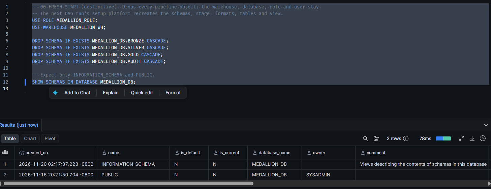

**Schemas dropped.** Only `INFORMATION_SCHEMA` and `PUBLIC` remain. The next DAG run recreates Bronze, Silver, Gold and Audit.

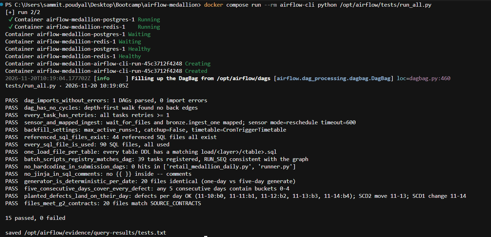

**Offline tests.** `tests/run_all.py` — 15 passed (DAG parse, SQL registry, planted defects, G2 contracts). No Snowflake write.

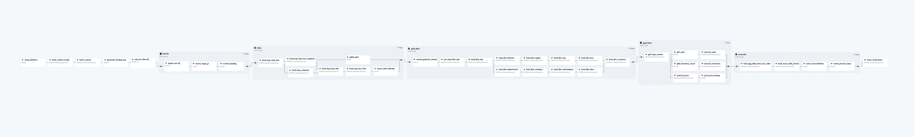

**DAG graph.** `setup_platform` → control → generate → sensor → bronze → silver → gold_dims → gold_facts → reconcile → `C_LOAD_DATES`.

---

## 1. History load (10–14 Nov)

Five backfill runs, one day at a time. Each calendar bucket plants one defect class.

### 1.1 Airflow

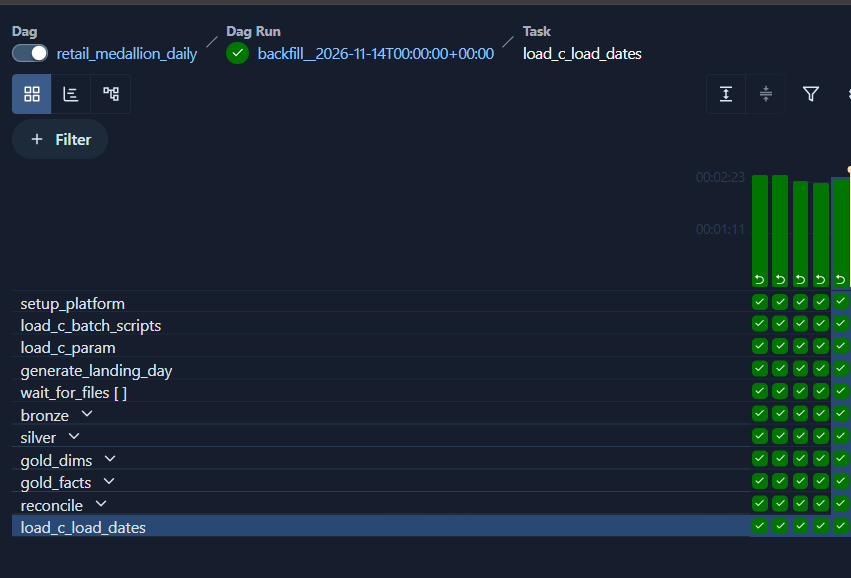

**Grid.** Five green runs: `backfill__2026-11-10` through `backfill__2026-11-14`.

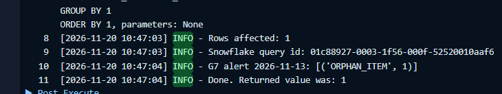

**G7 (13 Nov).** Orphan item `199999` quarantined before `FCT_SALES`; run stays green (alert only).

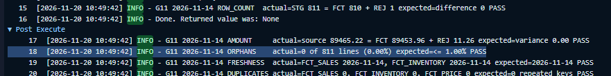

**G11 (14 Nov).** All five reconciliation checks print `PASS` in the task log.

**G8 (11 Nov).** Inventory row count vs prior day: `1501` / `1501`, drift `0.0%` (fail threshold 20%).

### 1.2 Layers and defects

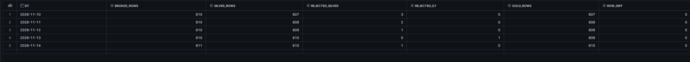

**Row flow.** Per day: Bronze → Silver → rejects → Gold. `ROW_DIFF = 0` means every source row is either in Gold or in `C_REJ_TABLE`.

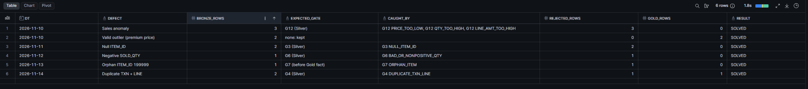

**Planted defects and the gates that caught them.** Every row ends `SOLVED`:

| Day | Defect | Gate | Outcome |
|---|---|---|---|
| 10 | Sales anomaly | G12 | All bad rows rejected; none in Gold |
| 10 | Valid outlier (premium) | none | Kept on purpose; present in Gold |
| 11 | Null `ITEM_ID` | G3 | Rejected; none in Gold |
| 12 | Negative qty | G6 | Rejected; none in Gold |
| 13 | Orphan `199999` | G7 | Rejected before fact load |
| 14 | Duplicate txn+line | G4 | One copy rejected; latest kept in Gold |

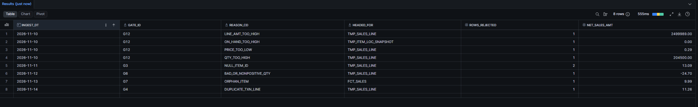

**Rejects by rule.** Counts and net amount held in `AUDIT.C_REJ_TABLE` per day / gate / reason.

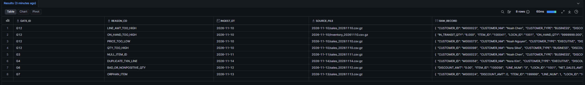

**One sample per rule.** `RAW_RECORD` keeps the full source line (G12 anomalies, G3 null, G4 duplicate, G6 negative qty, G7 orphan).

### 1.3 Reconciliation and SCD

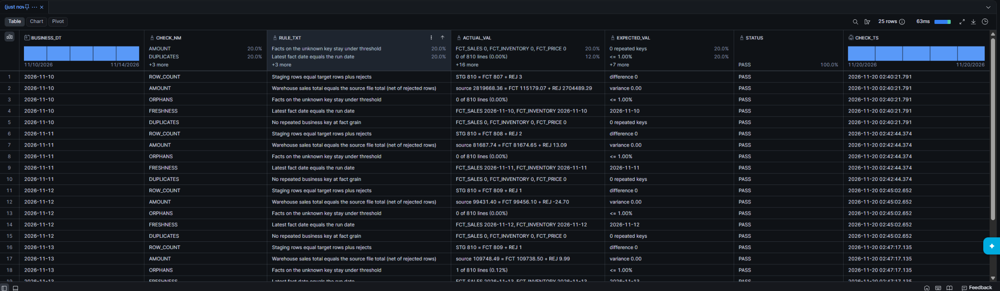

**G11 detail.** Five checks per day — all `PASS`:

1. **ROW_COUNT** — staging = Gold + rejects
2. **AMOUNT** — source net = Gold net + reject net
3. **ORPHANS** — unknown-key rejects under 1%
4. **FRESHNESS** — latest fact date = run date
5. **DUPLICATES** — no repeated business keys at fact grain

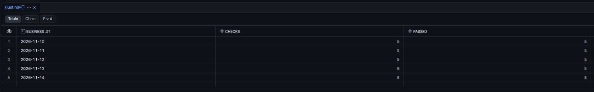

**G11 summary.** One line per day: `5 / 5` passed, no failed checks.

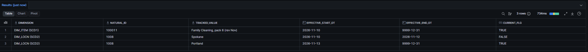

**Slowly changing dimensions.**

- **SCD2** store `1008`: Spokane closed 12 Nov → Portland current from 13 Nov (two versions).  
- **SCD1** item `100011`: one row; description overwritten to `(rev Nov)`.

### 1.4 Control tables and output

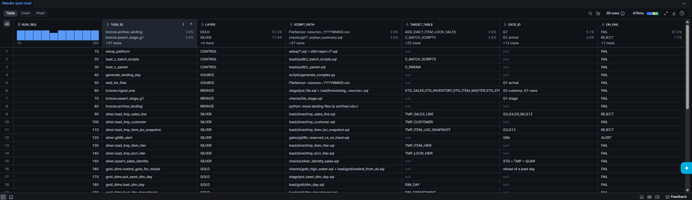

**`C_BATCH_SCRIPTS`.** Run order: task, layer, SQL path, target, gate, on-fail (`FAIL` / `REJECT` / `ALERT`).

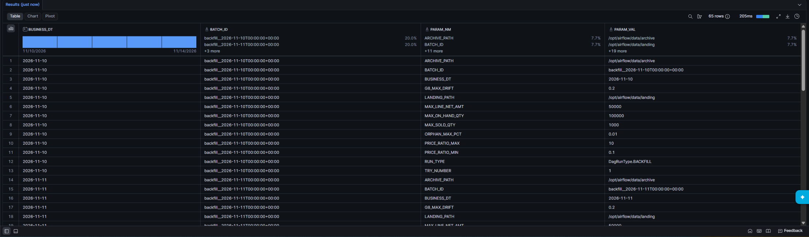

**`C_PARAM`.** Per-batch parameters (paths, outlier rules, `G8_MAX_DRIFT`, `ORPHAN_MAX_PCT`, `RUN_TYPE=BACKFILL`).

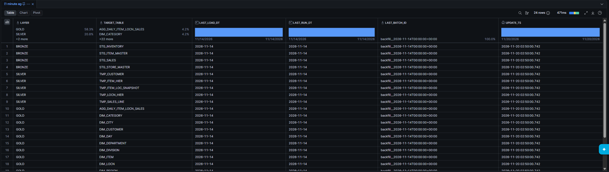

**`C_LOAD_DATES`.** Last successful load date per target. After the history backfill, Gold high-water = **2026-11-14**.

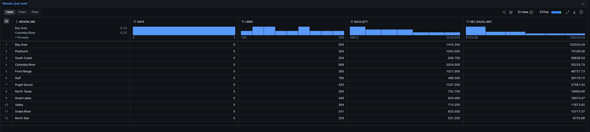

**Business view.** `VW_DAILY_ITEM_LOCN_SALES` rolled up to region (net sales, lines, qty).

---

## 2. Daily run (20 Nov)

Scheduled run cleared and completed after history.

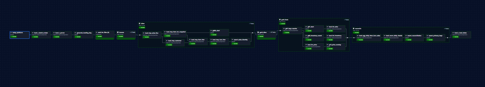

**Grid.** `scheduled__2026-11-20` green end-to-end.

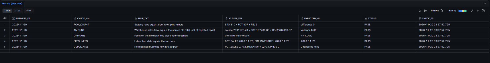

**G11 for 20 Nov.** Five checks, all `PASS`.

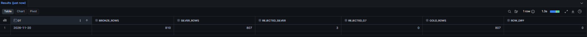

**Row flow 20 Nov.** `ROW_DIFF = 0` (810 Bronze = 807 Gold + 3 rejects).

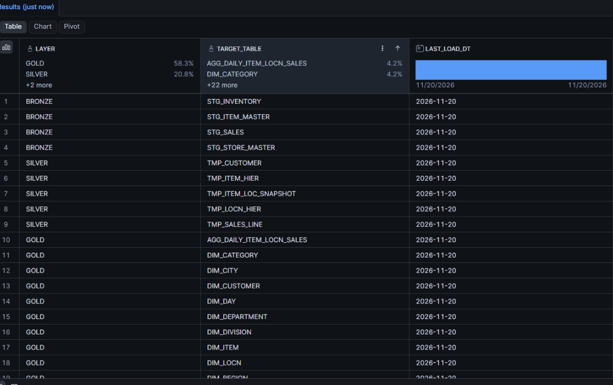

**`C_LOAD_DATES`.** Gold `LAST_LOAD_DT` advanced to **2026-11-20**.

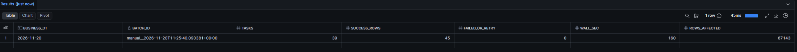

**`C_BATCH_LOG`.** One batch for 20 Nov: 39 tasks, 0 failures, ~160 s wall time, rows affected recorded.

---

## 3. Rerun proof (same day twice)

Clear 20 Nov again. Counts and SCD must match before vs after.

### Layer flow

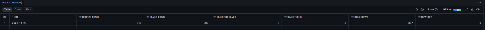

**Before Clear.** 20 Nov: Bronze 810 / Silver 807 / rejects 3 / Gold 807 / `ROW_DIFF = 0`.

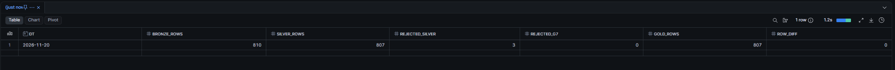

**After Clear.** Same numbers — idempotent reload of the latest day (no Gold rewind).

### SCD history

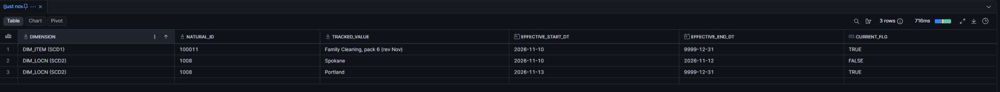

**SCD before.** Store 1008: Spokane → Portland; item 100011 revised. Two locn versions, one item row.

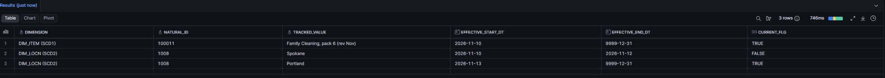

**SCD after.** Identical — no extra SCD2 versions from the second apply.

### Task attempts

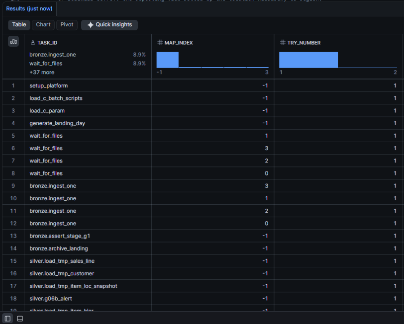

**`C_BATCH_LOG` detail.** Same tasks appear for both attempts — the day ran twice; Snowflake state is unchanged.

---

## 4. Reload one bad day (12 Nov)

Simulate a corrected past day: backfill **12 → 14**, then replay 20 Nov. Gold rewinds when the run date is older than `C_LOAD_DATES`.

**UI.** Backfill 12–14 in progress / complete on the grid (Silver and Gold facts expanded).

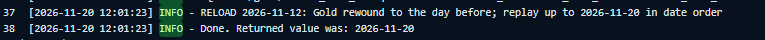

**12 Nov — rewind.** Log: `RELOAD 2026-11-12: Gold rewound to the day before; replay up to 2026-11-20`.

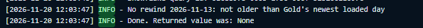

**13 Nov — no rewind.** Later days are past the new high-water mark, so they replay normally.

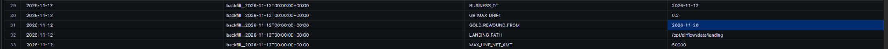

**Audit trail.** `C_PARAM` row `GOLD_REWOUND_FROM` on the 12 Nov batch — the rewind left a control-table fingerprint.

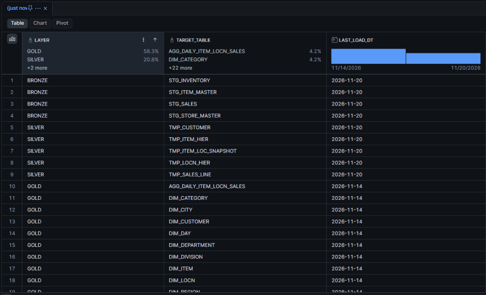

**After 12–14 replay.** Gold high-water sits at **14 Nov** until 20 Nov is cleared again.

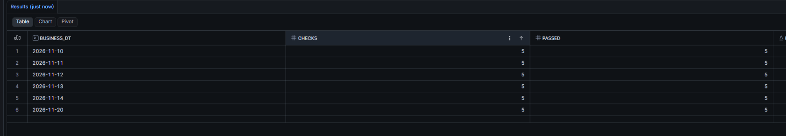

**Recon after reload.** Checks still `PASS` across the range (no broken totals from the rewind).

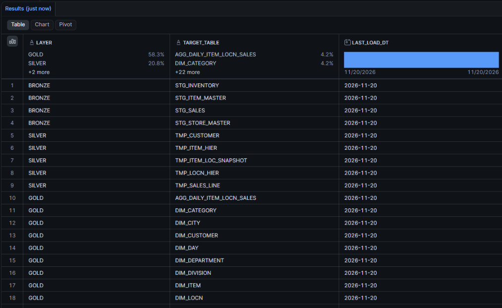

**Caught up.** After clearing 20 Nov, Gold `LAST_LOAD_DT` is **2026-11-20** again.

---

## What this pack shows

| Claim | Where |
|---|---|
| Pipeline builds from empty schemas | §0 |
| Defects caught at the right gate; Gold stays clean | §1.2 |
| Five recon rules pass every day | §1.3, §2, §4 |
| Control tables record order, params, load watermarks | §1.4, §2 |
| Same day twice → same Snowflake state | §3 |
| Past-day reload rewinds Gold, then replays forward | §4 |

Related: DAG `retail_medallion_daily`, Snowsight SQL in `evidence/snowsight/`, architecture in `context/architecture_simple.md`.
